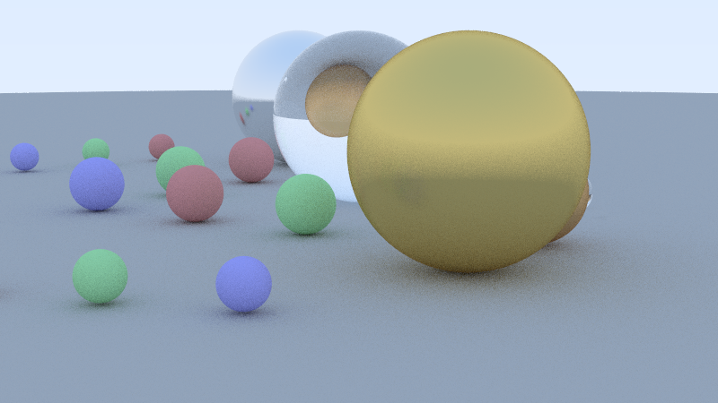

# Path Tracer paralelo en C++23 con oneTBB

[Read in English](README.md)

Path tracer físicamente basado, escrito en C++23. Renderiza esferas y cilindros
con tapas con materiales difusos, metálicos y refractivos, y paraleliza el
cálculo por píxel con oneTBB para poder comparar distintas estrategias de
reparto de trabajo.

Nació como proyecto en grupo de la asignatura *Arquitectura de Computadores* de
la Universidad Carlos III de Madrid (UC3M), sobre una plantilla de interfaz
proporcionada por la asignatura.



*`examples/scene_showcase.txt` renderizada con `examples/config_hq.txt`.*

## Características

- **Geometría:** esferas y cilindros con tapas (eje arbitrario), con
  intersección analítica rayo-superficie.
- **Materiales:**
  - *Matte*: dispersión difusa lambertiana.
  - *Metal*: reflexión especular con parámetro de rugosidad ("fuzz").
  - *Refractive*: ley de Snell con índice de refracción configurable (vidrio,
    agua, ...), reflexión interna total y aproximación de Schlick para Fresnel.
- **Cámara:** posición, punto de mira, vector "arriba", campo de visión y
  relación de aspecto, todo desde un fichero de configuración.
- **Calidad:** varias muestras aleatorias por píxel (antialiasing), profundidad
  máxima de rebotes configurable, corrección gamma y fondo con degradado entre
  dos colores.
- **Renderizado paralelo:** `tbb::parallel_for` sobre bloques 2D de píxeles, con
  número de hilos, particionador y tamaño de grano elegibles por línea de
  comandos.
- **Herramientas:** tests unitarios (GoogleTest + CTest), avisos del compilador
  estrictos (`-Werror`) y un preset opcional con clang-tidy.

## Arquitectura

```
common/          Biblioteca de dominio (no sabe nada de hilos)
  vector, ray, interval
  objects        Sphere, Cylinder
  material       Matte, Metal, Refractive
  camera         Path tracing y bucle de renderizado paralelo
  parsers        Lectores de configuración y escena en texto plano

par/             Renderizador de línea de comandos
  main.cpp       Argumentos: hilos, política de particionamiento, grano
  par_image.cpp  Buffer de imagen y salida PPM

utcommon/        Tests unitarios de la biblioteca common
utpar/           Tests unitarios del buffer de imagen / escritor PPM
examples/        Ficheros de configuración y escena de ejemplo
```

`common` es una biblioteca estática independiente de cómo se reparte el trabajo:
el trazado de rayos, las intersecciones y el scattering de materiales viven ahí.
`par` añade la interfaz de línea de comandos y la escritura de ficheros.

## Paralelización

La imagen se divide en un `tbb::blocked_range2d<int>` y cada bloque se procesa
con un cuerpo de `tbb::parallel_for`. Hay tres políticas de particionamiento:

| Política | Partitioner de TBB | Comportamiento |
|---|---|---|
| `auto` (por defecto) | `auto_partitioner` | Balanceo dinámico de carga; los bloques se subdividen si hace falta |
| `simple` | `simple_partitioner` | División recursiva hasta exactamente el tamaño de grano indicado |
| `static` | `static_partitioner` | Reparto uniforme entre hilos, sin rebalanceo y con mínimo overhead |

Cada hilo tiene su propio `std::mt19937_64` (`tbb::enumerable_thread_specific`),
inicializado a partir de las semillas de la configuración y un contador por hilo.
Así los hilos nunca comparten ni correlacionan secuencias aleatorias, algo
importante en un renderizador Monte Carlo. Como los hilos se numeran en el orden
en que empiezan a trabajar, la salida es reproducible con un solo hilo, pero no
es idéntica bit a bit entre ejecuciones con varios hilos.

El muestreo incluye un atajo deliberado: si ninguna de las cuatro primeras
muestras de un píxel golpea un objeto, se considera fondo puro y se omiten las
muestras restantes.

## Compilación

Requisitos:

- CMake 3.28 o superior y Ninja
- Un compilador con C++23 (desarrollado y probado con GCC 13.3)
- oneTBB (por ejemplo `libtbb-dev` en Debian/Ubuntu)
- Conexión a internet en la primera configuración: GSL y GoogleTest se
  descargan con `FetchContent`

```bash
cmake --preset default
cmake --build --preset gcc-release
```

El ejecutable queda en `out/build/default/par/Release/render-par`. La
compilación usa `-Wall -Wextra -Werror -pedantic -Wconversion -Wsign-conversion`,
así que cualquier aviso es un error. Hay un preset `clang-tidy`
(`cmake --preset clang-tidy`, `cmake --build --preset clang-tidy-release`) que
ejecuta análisis estático durante la compilación.

## Uso

```bash
./out/build/default/par/Release/render-par \
    <config_file> <scene_file> <salida.ppm> [hilos] [política] [grano]
```

| Argumento | Descripción |
|---|---|
| `hilos` | Número de hilos (por defecto: todos los disponibles) |
| `política` | `auto` (por defecto), `simple` o `static` |
| `grano` | Tamaño de bloque para `auto` (por defecto 2) y `simple` (por defecto 32); `static` lo ignora |

Ejemplo:

```bash
./out/build/default/par/Release/render-par \
    examples/config_hq.txt examples/scene_showcase.txt render.ppm 4 auto
```

La salida es una imagen PPM (P3) en texto plano. Para convertirla, por ejemplo
con ImageMagick: `magick render.ppm render.png`. El tiempo de render se
imprime por la salida de error estándar, de modo que es fácil comparar distintos
números de hilos, políticas y granos.

## Formatos de entrada

Ambos ficheros son texto plano. Se ignoran las líneas vacías y las que empiezan
por `#`.

**Configuración** (`clave: valores`). Todas las claves son opcionales; se
indican los valores por defecto.

| Clave | Valores | Por defecto |
|---|---|---|
| `aspect_ratio` | `w h` | `16 9` |
| `image_width` | píxeles | `1920` |
| `gamma` | > 0 | `2.2` |
| `camera_position` | `x y z` | `0 0 -10` |
| `camera_target` | `x y z` | `0 0 0` |
| `camera_north` | `x y z` | `0 1 0` |
| `field_of_view` | grados, (0, 180) | `90` |
| `samples_per_pixel` | entero ≥ 1 | `20` |
| `max_depth` | entero ≥ 1 | `5` |
| `material_rng_seed` | entero ≥ 1 | `13` |
| `ray_rng_seed` | entero ≥ 1 | `19` |
| `background_dark_color` | `r g b` en [0, 1] | `0.25 0.5 1` |
| `background_light_color` | `r g b` en [0, 1] | `1 1 1` |

**Escena.** Los materiales deben definirse antes que los objetos que los usan.

```
# matte: nombre r g b
matte: ground 0.5 0.5 0.5
# metal: nombre r g b fuzz
metal: silver 0.9 0.9 0.9 0.1
# refractive: nombre índice_de_refracción
refractive: glass 1.5

# sphere: cx cy cz radio material
sphere: 0 -100.5 0 100 ground
sphere: -1.0 0 0 0.5 glass
# cylinder: cx cy cz radio ax ay az material
cylinder: 1 0.5 0 0.3 0 1 0 silver
```

Los comentarios deben ir en su propia línea (no se admiten al final de una línea).

Un cilindro está centrado en `cx cy cz`; su vector eje `ax ay az` indica tanto
la dirección como la altura (la longitud del vector).

`examples/` incluye ficheros listos para usar: `config_small.txt` (vista
previa rápida), `config_hq.txt`, `config_large.txt` (1800 px de ancho, pensado
para `scene_random.txt`) y las escenas `scene_small.txt`, `scene_showcase.txt` y
`scene_random.txt` (muchas esferas y cilindros colocados al azar).

## Tests

```bash
ctest --test-dir out/build/default -C Release --output-on-failure
```

ejecuta los 90 tests unitarios: 80 en `utcommon` (vectores, rayos, objetos,
materiales, cámara, parsers) y 10 en `utpar` (buffer de imagen y salida PPM).
Los dos ejecutables de test también se pueden lanzar con `python3 utest.py`.

Si [gcovr](https://gcovr.com) está instalado, los targets `coverage-utcommon` y
`coverage-utpar` generan informes de cobertura.

## Licencia

Apache License 2.0, ver [LICENSE](./LICENSE).
