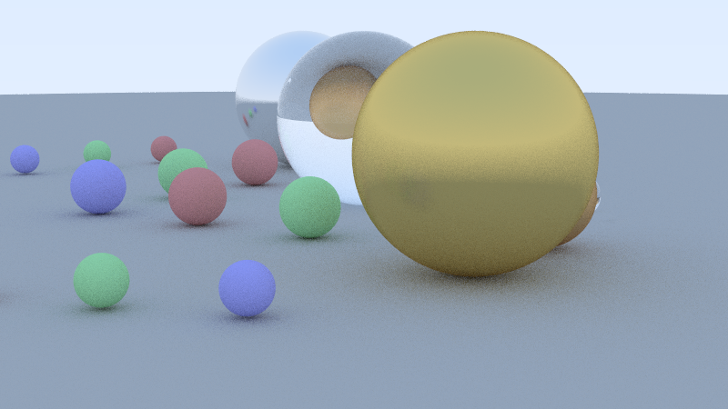

# Parallel Path Tracer in C++23 with oneTBB

[Leer en español](README.es.md)

A physically based path tracer written in C++23. It renders spheres and capped
cylinders with diffuse, metallic and refractive materials, and parallelizes the
per-pixel work with oneTBB so that different work-partitioning strategies can be
compared.

It started as a group project for the *Computer Architecture* course at
Universidad Carlos III de Madrid (UC3M), built on an interface template provided
by the course.



*`examples/scene_showcase.txt` rendered with `examples/config_hq.txt`.*

## Features

- **Geometry:** spheres and capped cylinders (arbitrary axis), analytic
  ray-surface intersection.
- **Materials:**
  - *Matte*: Lambertian diffuse scattering.
  - *Metal*: mirror reflection with a roughness ("fuzz") parameter.
  - *Refractive*: Snell's law with a configurable refraction index (glass,
    water, ...), total internal reflection and Schlick's Fresnel approximation.
- **Camera:** position, look-at point, "up" vector, field of view and aspect
  ratio, all set from a configuration file.
- **Quality controls:** multiple random samples per pixel (antialiasing),
  configurable maximum bounce depth, gamma correction and a two-color sky
  gradient as background.
- **Parallel rendering:** `tbb::parallel_for` over 2D pixel blocks, with the
  number of threads, partitioner and grain size selectable from the command
  line.
- **Tooling:** unit tests (GoogleTest + CTest), strict compiler warnings
  (`-Werror`) and an optional clang-tidy preset.

## Architecture

```
common/          Domain library (no knowledge of threads)
  vector, ray, interval
  objects        Sphere, Cylinder
  material       Matte, Metal, Refractive
  camera         Path tracing and the parallel render loop
  parsers        Plain-text configuration and scene readers

par/             Command-line renderer
  main.cpp       Argument handling: threads, partition policy, grain size
  par_image.cpp  Image buffer and PPM output

utcommon/        Unit tests for the common library
utpar/           Unit tests for the image buffer / PPM writer
examples/        Sample configuration and scene files
```

`common` is a static library that is independent of how the work is split: ray
tracing, intersections and material scattering live there. `par` adds the
command-line interface and file output on top of it.

## Parallelization

The image is divided into a `tbb::blocked_range2d<int>` and every block is
shaded by a `tbb::parallel_for` body. Three partitioning policies are available:

| Policy | TBB partitioner | Behavior |
|---|---|---|
| `auto` (default) | `auto_partitioner` | Dynamic load balancing; blocks are split further when needed |
| `simple` | `simple_partitioner` | Recursive splitting until blocks are no larger than the grain size |
| `static` | `static_partitioner` | Even split between threads, no rebalancing, minimal scheduling overhead |

Each thread owns its own `std::mt19937_64` (`tbb::enumerable_thread_specific`),
seeded from the configuration seeds and a per-thread counter. Threads therefore
never share or correlate random streams, which matters in a Monte Carlo
renderer. Because threads are numbered in the order they first run, output is
reproducible with one thread but not bit-for-bit identical across multi-threaded
runs.

Pixel sampling has one deliberate shortcut: if none of the first four samples of
a pixel hits an object, the pixel is treated as pure background and the
remaining samples are skipped.

## Build

Requirements:

- CMake 3.28 or newer and Ninja
- A C++23 compiler (developed and tested with GCC 13.3)
- oneTBB (for example `libtbb-dev` on Debian/Ubuntu)
- Internet access on the first configure: GSL and GoogleTest are downloaded
  with `FetchContent`

```bash
cmake --preset default
cmake --build --preset gcc-release
```

The executable is `out/build/default/par/Release/render-par`. The build uses
`-Wall -Wextra -Werror -pedantic -Wconversion -Wsign-conversion`, so any warning
is a compile error. A `clang-tidy` preset (`cmake --preset clang-tidy`,
`cmake --build --preset clang-tidy-release`) runs static analysis during the
build.

## Usage

```bash
./out/build/default/par/Release/render-par \
    <config_file> <scene_file> <output.ppm> [threads] [policy] [grain_size]
```

| Argument | Description |
|---|---|
| `threads` | Number of threads (default: all available) |
| `policy` | `auto` (default), `simple` or `static` |
| `grain_size` | Block size for `auto` (default 2) and `simple` (default 32); ignored by `static` |

Example:

```bash
./out/build/default/par/Release/render-par \
    examples/config_hq.txt examples/scene_showcase.txt render.ppm 4 auto
```

The output is a plain-text PPM (P3) image. To convert it, for example with
ImageMagick: `magick render.ppm render.png`. The render time is printed to
standard error, so different thread counts, policies and grain sizes can be
compared easily.

## Input formats

Both files are plain text. Empty lines and lines starting with `#` are ignored.

**Configuration** (`key: values`). Every key is optional; defaults are shown.

| Key | Values | Default |
|---|---|---|
| `aspect_ratio` | `w h` | `16 9` |
| `image_width` | pixels | `1920` |
| `gamma` | > 0 | `2.2` |
| `camera_position` | `x y z` | `0 0 -10` |
| `camera_target` | `x y z` | `0 0 0` |
| `camera_north` | `x y z` | `0 1 0` |
| `field_of_view` | degrees, (0, 180) | `90` |
| `samples_per_pixel` | integer ≥ 1 | `20` |
| `max_depth` | integer ≥ 1 | `5` |
| `material_rng_seed` | integer ≥ 1 | `13` |
| `ray_rng_seed` | integer ≥ 1 | `19` |
| `background_dark_color` | `r g b` in [0, 1] | `0.25 0.5 1` |
| `background_light_color` | `r g b` in [0, 1] | `1 1 1` |

**Scene.** Materials must be defined before the objects that use them.

```
# matte: name r g b
matte: ground 0.5 0.5 0.5
# metal: name r g b fuzz
metal: silver 0.9 0.9 0.9 0.1
# refractive: name refraction_index
refractive: glass 1.5

# sphere: cx cy cz radius material
sphere: 0 -100.5 0 100 ground
sphere: -1.0 0 0 0.5 glass
# cylinder: cx cy cz radius ax ay az material
cylinder: 1 0.5 0 0.3 0 1 0 silver
```

Comments must be on their own line (no trailing comments).

A cylinder is centered on `cx cy cz`; its axis vector `ax ay az` gives both its
direction and its height (the length of the vector).

`examples/` contains ready-to-use files: `config_small.txt` (fast preview),
`config_hq.txt`, `config_large.txt` (1800 px wide, intended for
`scene_random.txt`), and the scenes `scene_small.txt`, `scene_showcase.txt` and
`scene_random.txt` (many randomly placed spheres and cylinders).

## Tests

```bash
ctest --test-dir out/build/default -C Release --output-on-failure
```

runs the 90 unit tests: 80 in `utcommon` (vectors, rays, objects, materials,
camera, parsers) and 10 in `utpar` (image buffer and PPM output). The two test
executables can also be run directly with `python3 utest.py`.

If [gcovr](https://gcovr.com) is installed, the `coverage-utcommon` and
`coverage-utpar` targets generate coverage reports.

## License

Apache License 2.0, see [LICENSE](./LICENSE).
